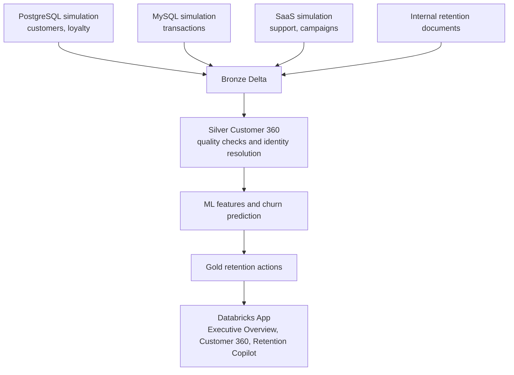

# retail-intelligence

Databricks-native prototype for a retail Customer 360, churn prediction, and retention copilot demo.

## Business Problem

Retail leaders have fragmented customer, loyalty, transaction, support, campaign, and policy data. This prototype will demonstrate a governed path from unified data to churn risk to grounded retention action:

`Unified Data -> Predict Risk -> Generate Action -> Drive Outcome`

## Architecture



## Current Phase

Phase 4 adds deterministic, grounded retention-action generation to the existing Bronze/Silver/Gold pipeline.

## Local Validation

```powershell
python -m pytest
databricks bundle validate --strict -t dev --profile sa_profile
databricks experiments get-by-name /Users/reza.khamooshi@gmail.com/retail-intelligence/churn --profile sa_profile
```

## Deploy And Run

Use only after reviewing the proposed resources:

```powershell
databricks bundle deploy -t dev --profile sa_profile
databricks bundle run retail_intelligence_pipeline -t dev --profile sa_profile
```

## Known Limitations

The Databricks App is intentionally deferred to the next phase. Current generated actions use deterministic fallback logic and should not be described as live LLM output.
