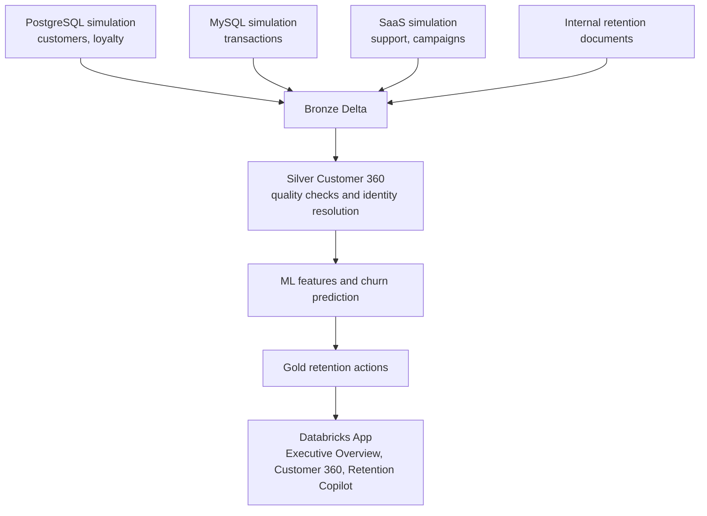

# retail-intelligence

Databricks-native prototype for a retail Customer 360, churn prediction, and retention copilot demo.

## Business Problem

Retail leaders have fragmented customer, loyalty, transaction, support, campaign, and policy data. This prototype will demonstrate a governed path from unified data to churn risk to grounded retention action:

`Unified Data -> Predict Risk -> Generate Action -> Drive Outcome`

## Architecture



## Current Phase

Phase 6 deployed the AppKit source for the three-page Databricks App: Executive Overview, Customer 360, and Retention Copilot.

## Local Validation

```powershell
python -m pytest
databricks bundle validate --strict -t dev --profile sa_profile
databricks experiments get-by-name /Users/reza.khamooshi@gmail.com/retail-intelligence/churn --profile sa_profile
```

App validation and deployment:

```powershell
cd app\retail-intelligence
npm.cmd install
npm.cmd run typegen
npm.cmd run typecheck
databricks apps validate --profile sa_profile
cd ..\..
databricks bundle deploy -t dev --profile sa_profile
databricks bundle run retail_intelligence_app -t dev --profile sa_profile
```

## Deploy And Run

Use only after reviewing the proposed resources:

```powershell
databricks bundle deploy -t dev --profile sa_profile
databricks bundle run retail_intelligence_pipeline -t dev --profile sa_profile
```

## Known Limitations

Current generated actions use deterministic fallback logic and should not be described as live LLM output.

If the app shows `Unable to load this view`, verify the Databricks App service principal has read access to the Unity Catalog data:

```sql
GRANT USE CATALOG ON CATALOG workspace TO `71dbfb5a-4671-4978-8c84-ee64069327f1`;
GRANT USE SCHEMA, SELECT ON SCHEMA workspace.retail_intelligence TO `71dbfb5a-4671-4978-8c84-ee64069327f1`;
```

## App URL

https://retail-intelligence-7474645848673684.aws.databricksapps.com
